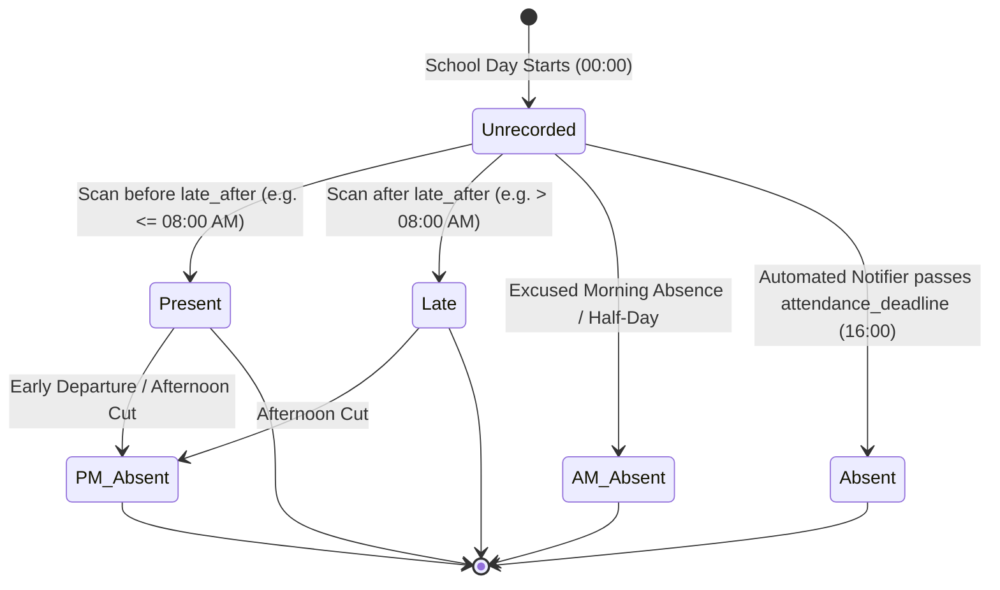

# Daily Attendance Lifecycle & State Transitions

This document defines the daily states of an attendance record from morning opening to evening finalization.

---

### Daily State Transitions

---

### State Definitions

| State | DB `status` Value | Daily Credit | Parent SMS Trigger | Notes |
| :--- | :--- | :--- | :--- | :--- |
| **Unrecorded** | *(no record)* | 0.0 | No | Pending student arrival |
| **Present** | `'present'` | 1.0 | Optional | Student checked in on time |
| **Late** | `'late'` | 1.0 | Yes | Arrived after `late_after` cutoff |
| **AM Absent** | `'am_absent'` | 0.5 | Yes | Half-day credit; upper diagonal mark on SF2 |
| **PM Absent** | `'pm_absent'` | 0.5 | Yes | Half-day credit; lower diagonal mark on SF2 |
| **Absent** | `'absent'` | 0.0 | Yes | Full day absence; 'X' mark on SF2 |

---

### End-of-Day Automated Notifier
In `backend/services/notifications.js`:
- The background cron runner checks daily at `attendance_deadline` (default 16:00).
- If an enrolled student has no attendance record for the day, an unexcused absence event is generated.
- Consecutive absences are calculated. If the streak reaches $\ge 5$, a SARDO risk flag is raised.
- If SMS is enabled, guardian notification is queued in `sms_logs`.
